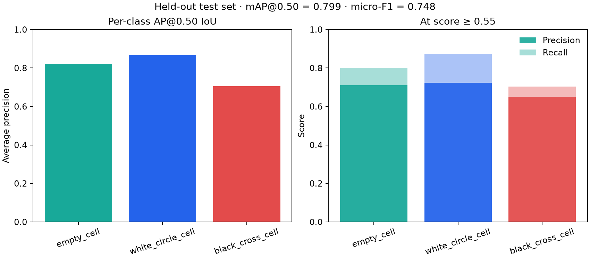
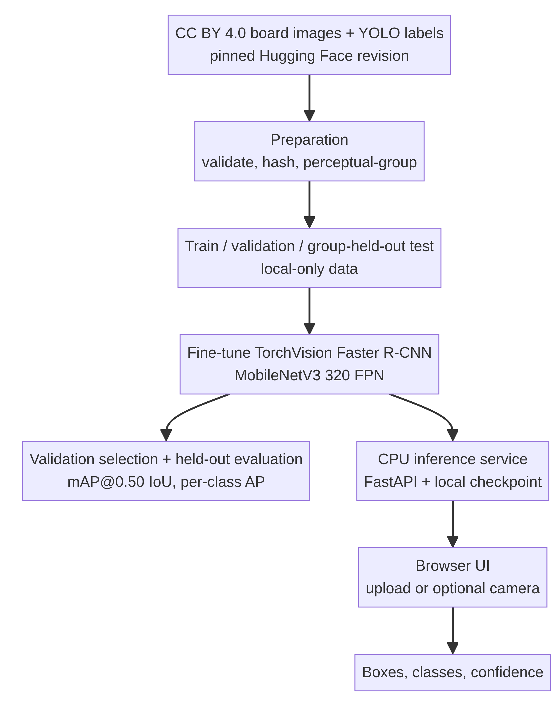

# BoardWatch — Object Detection AI

[](https://github.com/bereket-web/object-detection-ai/actions/workflows/ci.yml)

BoardWatch is a local-first object-detection application for **tic-tac-toe board occupancy**. It detects board-cell boxes and classifies each as `empty_cell`, `white_circle_cell`, or `black_cross_cell` using a fine-tuned TorchVision Faster R-CNN with a MobileNetV3-Large 320 FPN backbone.

This is a small-data engineering demonstration, not a general-purpose detector. It uses 59 real board photos. A perceptual-similarity screen found two multi-image visual groups (20 and 37 images) plus two singleton images. The 20-image group is held out for the final test. The remaining 39 images are divided into 30 training and 9 validation images; validation shares the larger visual group with training and is used only for checkpoint and threshold selection.

## Results from the corrected run

| Evidence | Result |
|---|---|
| Fine-tuning | 10 CPU epochs, batch size 2, seed 2026; 101.7 seconds; epoch 10 selected at validation mAP@0.50 = **0.950** |
| Validation-selected score threshold | **0.55**, selected by micro-F1 on validation only (validation F1 **0.895**) |
| Group-held-out test | 20 images / 180 cell boxes; mAP@0.50 = **0.799**; micro-precision **0.702**, recall **0.800**, F1 **0.748** |
| Test AP@0.50 by class | Empty **0.823** · Circle **0.867** · Cross **0.706** |
| CPU image latency | Median **77.3 ms** (range 67.8–83.9 ms) on one 640×480 test image after two warm-ups and eight timed runs in this environment |
| Automated checks | 17 offline tests pass; Ruff, format, compile, and wheel/sdist checks pass; CI workflow covers Python 3.10 and 3.12 |

The held-out result is lower than the original random-split score, which demonstrates why the similarity-aware split matters. The source has no capture-session metadata, so perceptual grouping is only a proxy for capture independence; this single test group is not evidence of broad generalization. The model remains a narrow experimental prototype.





Source photos and prediction overlays are not included in the public repository. After downloading the dataset locally, evaluation recreates a local overlay as an ignored file.

## What it demonstrates

- Pinned dataset preparation, image and YOLO-label validation, SHA-256 manifests, and transitive perceptual-hash grouping.
- Group-held-out test evaluation, validation-only checkpoint selection, and a reproducible validation-only confidence-threshold sweep.
- Transfer learning with train-only flips and brightness/contrast augmentation plus a frozen-backbone warm-up.
- 101-point interpolated AP@0.50, per-class AP, thresholded precision/recall/F1, charts, and a local-only prediction overlay.
- CPU inference through a CLI, FastAPI JSON endpoint, responsive image-upload UI, and optional low-rate webcam polling.
- Offline tests, package builds, and GitHub Actions on Python 3.10 and 3.12.

## Run locally

Python 3.10+ and `uv` are recommended. Training downloads TorchVision's public COCO_V1 initialization checkpoint on first run. Dataset images, processed splits, generated overlays, and the fine-tuned checkpoint stay local and are ignored by Git. In a source checkout, project data lives under the repository root; an installed wheel uses the current working directory, or set `BOARDWATCH_HOME` to choose a data/artifact/report root.

```bash
uv sync --extra test
uv run boardwatch prepare
uv run boardwatch train --epochs 10
uv run boardwatch select-threshold
uv run boardwatch evaluate --split test --score-threshold 0.55
uv run boardwatch serve
```

For a fresh run, read the selected value from `reports/threshold_selection.json` and pass that `selected_threshold` to the test command instead of assuming `0.55`. The release's CLI, API, and browser demo default to this run's calibrated threshold of 0.55; after retraining, update `DEFAULT_SCORE_THRESHOLD` to the new validation-selected value if you want the app default to follow it. Do not select a threshold using test results. Open <http://127.0.0.1:8000>; the health endpoint is `/health` and OpenAPI docs are at `/docs`.

Single-image inference:

```bash
uv run boardwatch predict data/processed/test/images/top-camera02.jpg --output prediction.jpg
```

Run checks:

```bash
uv sync --locked --extra test
uv run pytest
uv run ruff check src tests
uv run ruff format --check src tests
uv build
```

## Data, attribution, and model

Training and evaluation use 59 real board photos and matching YOLO labels from [zoncoen's Tic-tac-toe Board Dataset](https://huggingface.co/datasets/zoncoen/tic-tac-toe-board-dataset), pinned to revision `8d3782b5a9992abca0e5611e9473eac7a1f98822`. The source card declares CC BY 4.0. Attribution and the release boundary are documented in [DATA_SOURCES.md](DATA_SOURCES.md). Raw images and image-derived splits are downloaded locally and are not committed.

The detector starts from TorchVision's [`FasterRCNN_MobileNet_V3_Large_320_FPN_Weights.COCO_V1`](https://docs.pytorch.org/vision/stable/models/generated/torchvision.models.detection.fasterrcnn_mobilenet_v3_large_320_fpn.html) checkpoint. Fine-tuned weights remain local and are not distributed. The checkpoint and dataset have separate upstream terms; see the [model card](docs/model_card.md) and [data provenance](DATA_SOURCES.md).

## Evaluation protocol and evidence

The preparation step computes a 63-bit grayscale DCT perceptual hash for each image and groups connected components with Hamming distance at most 4. The resulting groups contain 1, 20, 37, and 1 images. The entire 20-image group is held out for test. The remaining images are deterministically shuffled with seed 2026 into 30 train and 9 validation images. The test group has no cross-split perceptual-hash neighbor within the threshold. Validation and training do share the 37-image group; validation is for model/threshold selection, not an independent generalization estimate. Because no session metadata exists, the perceptual split cannot prove true capture-session independence.

Validation selects the checkpoint by mAP@0.50. `boardwatch select-threshold` chooses the score threshold from a fixed sweep by maximum validation micro-F1 (ties prefer precision, then the higher threshold). The test set is evaluated once at the selected threshold. AP is 101-point interpolated AP at IoU ≥ 0.50, using detections with score ≥ 0.001; it is **not** COCO mAP@[.50:.95]. See the full [evaluation protocol](docs/evaluation.md).

Generated, pixel-free evidence includes [dataset summary](reports/dataset_summary.json), [split manifest](reports/split_manifest.csv), [similarity audit](reports/similarity_audit.json), [training summary](reports/training_summary.json), [epoch history](reports/training_history.csv), [validation threshold sweep](reports/threshold_selection.json), [CPU latency report](reports/inference_latency.json), [held-out test metrics](reports/evaluation_test.json), and [test chart](reports/evaluation_test.png). The 73 MB fine-tuned checkpoint and all source photos remain local.

## Limitations and safe use

The corpus is small and narrowly top-down. The test uses one visually distinct 20-image group; pHash grouping is not a substitute for capture-session IDs, and only two large visual groups were available. The lower test result compared with the original random split indicates substantial capture-similarity risk. Cross AP is lowest, and confidence scores are not calibrated probabilities. Other board styles, angled views, token designs, and arbitrary objects are out of scope without new data and external evaluation.

The optional browser-camera loop is rate-limited but was not tested on physical camera hardware. The local API has no authentication, quotas, or production hardening; keep it bound to `127.0.0.1`. Uploaded images are processed in memory and are not intentionally persisted. No hosted demo, Hugging Face model, or Space is published; the repository excludes both source imagery and model weights.

## Repository layout

```text
src/boardwatch/       preparation, training, evaluation, inference, API, UI
 data/raw/            downloaded original images (ignored)
 data/processed/      local image-level splits (ignored)
artifacts/            fine-tuned checkpoint (ignored)
reports/              manifests, aggregate metrics, charts, and audit reports
docs/                 architecture, evaluation protocol, and model card
tests/                offline unit and API tests
```

## Next improvements

- Add more independently captured and appropriately licensed board images, with capture-session metadata for a stronger group-held-out evaluation.
- Improve cross detection with broader token styles and lighting, then audit annotations and class-specific errors.
- Evaluate on additional board layouts and real camera hardware; the current webcam path is a prototype only.
- Revisit model-weight and dataset distribution terms before publishing weights or enabling a hosted demo.
